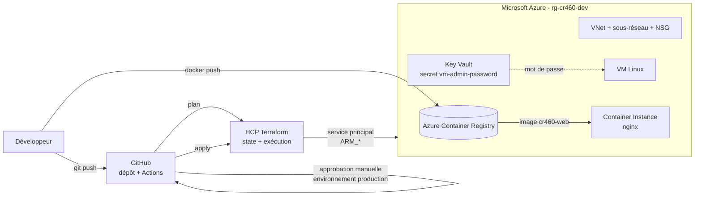

# CR460Projectprep
# Pipeline CI/CD sur Azure avec GitHub, Terraform Cloud et GitHub Actions

Projet d'infrastructure as code réalisé dans le cadre du cours **CR460 – Infonuagique** (Polytechnique Montréal). Un simple `git push` déploie une infrastructure complète sur Microsoft Azure, et un workflow GitHub Actions impose une **approbation manuelle** entre le `terraform plan` et le `terraform apply`.

## Ce que fait le projet

- Provisionne sur Azure, avec **Terraform**, un groupe de ressources, un réseau virtuel, une machine virtuelle Linux, un Key Vault, un registre de conteneurs (ACR) et un conteneur Docker (Azure Container Instances).
- Exécute Terraform dans **HCP Terraform (Terraform Cloud)**, qui conserve l'état (state) et les identifiants Azure.
- Stocke le mot de passe de la VM dans **Azure Key Vault** : Terraform le génère, le range comme secret, puis la VM le lit depuis le Key Vault.
- Construit une image Docker (nginx) et la publie dans l'ACR **avant** de déployer le conteneur.
- Applique un tag de gestion des coûts (`Projet = DevoirCR460`) sur toutes les ressources.
- Protège le déploiement avec un environnement GitHub `production` à **réviseur obligatoire**.

## Architecture



## Structure du dépôt

```
.
├── .github/workflows/terraform.yml   # Pipeline : plan -> approbation -> apply
├── infra/
│   ├── main.tf                       # Ressources Azure + backend HCP Terraform
│   ├── variables.tf                  # Région, noms, taille de VM, image_tag...
│   └── outputs.tf                    # IP de la VM, nom du Key Vault, URL du conteneur...
├── app/
│   ├── Dockerfile                    # nginx:alpine
│   └── index.html                    # Page servie par le conteneur
└── docs/
    ├── GUIDE.md                      # Guide pas à pas pour refaire le projet de A à Z
    └── ENTREVUE.md                   # Décisions techniques, difficultés, améliorations
```

## Ressources déployées

| Ressource | Nom | Rôle |
|---|---|---|
| Groupe de ressources | `rg-cr460-dev` | Contient toute l'infrastructure |
| Réseau virtuel + sous-réseau | `vnet-cr460` (10.0.0.0/16), `snet-cr460` (10.0.1.0/24) | Réseau de la VM |
| Groupe de sécurité réseau | `nsg-cr460` | Autorise SSH (port 22) |
| Key Vault + secret | `kv-cr460-<suffixe>`, `vm-admin-password` | Stocke le mot de passe de la VM |
| Machine virtuelle | `vm-cr460` | Ubuntu 22.04, taille via `var.vm_size` |
| Azure Container Registry | `acrcr460<suffixe>` | Stocke l'image Docker |
| Container Instance | `aci-cr460` | Exécute l'image nginx |

Le suffixe aléatoire de 5 caractères évite les conflits de noms globaux (Key Vault, ACR).

## Variables principales

| Variable | Défaut | Description |
|---|---|---|
| `location` | `canadacentral` | Région Azure |
| `prefix` | `cr460` | Préfixe des noms de ressources |
| `environment` | `dev` | Nom de l'environnement |
| `vm_size` | `Standard_DC1s_v3` | Taille de la VM |
| `allowed_ssh_cidr` | `*` | Plage autorisée pour SSH (à restreindre) |
| `image_tag` | `""` | Tag de l'image dans l'ACR. Vide : le conteneur n'est pas créé |

## Pipeline GitHub Actions

Le workflow `terraform.yml` se déclenche à chaque push sur `main` qui modifie `infra/**` ou le workflow lui-même, ou manuellement (`workflow_dispatch`).

1. **Terraform Plan** : `init`, `validate`, `plan`.
2. **Approbation manuelle** : le job `apply` utilise l'environnement `production`, configuré avec *Required reviewers*. Le déploiement reste en attente jusqu'à validation.
3. **Terraform Apply** : s'exécute seulement après approbation.

Prérequis côté GitHub : un secret `TF_API_TOKEN` (token d'API utilisateur HCP Terraform) et l'environnement `production`.
Prérequis côté HCP Terraform : le workspace doit être piloté par CLI/API (dépôt non connecté), sinon l'apply lancé par GitHub Actions est refusé.

## Refaire le projet

Voir le guide pas à pas : [`docs/GUIDE.md`](docs/GUIDE.md).

## Sécurité

- Aucun secret dans le dépôt : les identifiants Azure (`ARM_*`) sont des variables d'environnement du workspace HCP Terraform, dont `ARM_CLIENT_SECRET` marqué *Sensitive*.
- Le token HCP Terraform est stocké dans les secrets GitHub Actions.
- Le service principal a le rôle `Contributor` limité à l'abonnement de test et a été supprimé après le devoir.
- Limites connues et pistes d'amélioration : voir [`docs/ENTREVUE.md`](docs/ENTREVUE.md).

## Nettoyage

Pour arrêter tout coût : dans HCP Terraform, *Settings → Destruction and deletion → Queue destroy plan*, puis confirmer. Supprimer ensuite le service principal (`az ad sp delete`) et les tokens.

## Technologies

Terraform · HCP Terraform · Microsoft Azure (VNet, VM, Key Vault, ACR, ACI) · GitHub Actions · Docker · Azure CLI · PowerShell · VS Code

## Auteur

Cabral ([@cabral2604](https://github.com/cabral2604)) – étudiant en cybersécurité, Polytechnique Montréal.